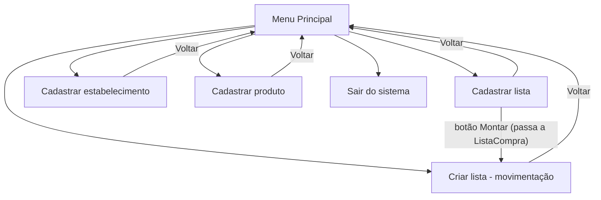

# Lista de Compras

**Trabalho Bimestral — Paradigma de Programação**

Aplicação desktop em **Java + JavaFX 21** (telas feitas no Scene Builder, em FXML), que grava os dados em JSON com a biblioteca **Gson**.

---

## Sumário

1. [Integrantes do grupo](#1-integrantes-do-grupo)
2. [Descrição do funcionamento do sistema](#2-descrição-do-funcionamento-do-sistema)
3. [Estrutura das classes](#3-estrutura-das-classes)
4. [Conceitos de POO utilizados](#4-conceitos-de-poo-utilizados)
5. [Passagem de dados entre telas](#5-passagem-de-dados-entre-telas)
6. [Utilização de herança](#6-utilização-de-herança)
7. [Utilização de polimorfismo](#7-utilização-de-polimorfismo)
8. [Fluxo da aplicação](#8-fluxo-da-aplicação)
9. [Como executar](#9-como-executar)

---

## 1. Integrantes do grupo

| Integrante      | RA          |
|-----------------|-------------|
| Aguinaldo Alves | 403748-2025 |
| Gustavo Pereira | 428811-2026 |
| Gustavo Miguel  | 393824-2025 |
| João Pedro      | 424686-2026 |

---

## 2. Descrição do funcionamento do sistema

O **Lista de Compras** ajuda o usuário a organizar as compras da casa. Ele permite:

- **Cadastrar listas de compras** (ex.: "Compras da semana"). A tabela da tela mostra o nome da lista e um resumo com a quantidade de produtos e o valor total.
- **Cadastrar estabelecimentos** (ex.: "Mercado Central") com os dias da semana em que costuma haver promoção (botões de Dom a Sáb).
- **Cadastrar produtos** com descrição, unidade de medida (Unidade, Quilograma, Litro, Pacote ou Caixa) e foto opcional. A foto pode vir do computador (JPEG/PNG) ou de um link da internet; sem foto, aparece uma imagem padrão.
- **Montar a lista** (tela "Criar lista"): o usuário escolhe a lista, o estabelecimento (opcional) e o produto, e informa a quantidade e o valor unitário (opcional). A tabela mostra os itens com subtotal, e o rodapé mostra o total de itens e o valor total. Se o mesmo produto for incluído de novo na mesma lista e no mesmo estabelecimento, a quantidade é somada ao item que já existe.

### Regras gerais

- Em todas as telas de cadastro é possível **incluir**, **consultar** (na tabela ou nos cartões da própria tela), **editar** (o botão muda para "Salvar" e aparece "Cancelar") e **excluir** (sempre com confirmação).
- Os nomes não podem ficar em branco nem se repetir. A comparação ignora maiúsculas e os espaços do início e do fim.
- Um cadastro em uso em algum item de lista não pode ser excluído. O sistema mostra uma mensagem diferente para cada tipo de cadastro.
- Todos os dados são gravados automaticamente no arquivo `dados/lista_compras.json` a cada operação e são carregados quando o sistema abre. Se o arquivo não existir, ele é criado vazio. Se estiver corrompido, o sistema avisa, guarda uma cópia `.corrompido` e abre sem dados.
- Ao sair (pelo botão "Sair do sistema" ou pelo "X" da janela), o sistema pede confirmação, avisa se há algum cadastro digitado e ainda não confirmado, e grava os dados antes de fechar.

### Onde ficam as 3 telas exigidas

| Tela exigida     | Onde está no sistema                                                                                   |
|------------------|--------------------------------------------------------------------------------------------------------|
| **Cadastro**     | Cadastro de Lista, de Estabelecimento e de Produto                                                     |
| **Consulta**     | A tabela ou os cartões dentro dessas mesmas telas (o documento de requisitos pede a consulta na própria tela, RN010) |
| **Movimentação** | Criar Lista de Compras (inclui, altera e exclui itens)                                                 |

---

## 3. Estrutura das classes

O projeto segue o padrão **MVC (Model, View, Controller)**.

```
src/main/java
├── org.example
│   └── Main ............................ Ponto de entrada. Classe comum (não herda de
│                                          Application) que chama App.main(), evitando o erro
│                                          "JavaFX runtime components are missing".
│
├── br.com.listacompras
│   └── App ............................. Herda de javafx.application.Application. Carrega o
│                                          JSON, abre o MenuPrincipal.fxml e trata o "X".
│
├── br.com.listacompras.model  (regras de negócio e dados)
│   ├── Cadastro (abstrata) ............. Classe pai: id, nome, temMesmoNome() e os métodos
│   │                                      abstratos getDetalhe(), getMensagemEmUso() e
│   │                                      estaVinculadoA().
│   ├── ListaCompra ..................... extends Cadastro. Lista de compras.
│   ├── Estabelecimento ................. extends Cadastro. List<DayOfWeek> com os dias de promoção.
│   ├── Produto ......................... extends Cadastro. Unidade de medida e caminho da foto.
│   ├── ItemLista ....................... Produto dentro de uma lista: ids da lista, do
│   │                                      estabelecimento e do produto, unidade, quantidade,
│   │                                      valor unitário e subtotal.
│   ├── UnidadeMedida (enum) ............ UNIDADE, QUILOGRAMA, LITRO, PACOTE, CAIXA.
│   ├── Repositorio ..................... Singleton. Guarda as 4 listas de dados (D1 a D4 do
│   │                                      DFD) e aplica as regras antes de qualquer alteração.
│   ├── Persistencia .................... Lê e grava o arquivo JSON com a biblioteca Gson.
│   └── ValidacaoException .............. extends RuntimeException. Erro de regra de negócio
│                                          com a mensagem para o usuário.
│
├── br.com.listacompras.controller  (lógica de cada tela)
│   ├── MenuPrincipalController ......... Navega para as 4 telas e sai do sistema.
│   ├── CadastroListaController ......... Cadastro/consulta de listas + botão "Montar".
│   ├── CadastroEstabelecimentoController Cadastro/consulta de estabelecimentos.
│   ├── CadastroProdutoController ....... Cadastro/consulta de produtos em cartões, com foto.
│   ├── CriarListaController ............ Movimentação: itens e totalizadores.
│   └── ExclusaoCadastro ................ Exclusão única e polimórfica para os 3 cadastros.
│
└── br.com.listacompras.util  (classes auxiliares reutilizadas)
    ├── Navegador ....................... Troca de tela e devolve o controller da tela nova.
    ├── Mensagem ........................ Janelas de informação, aviso e confirmação (Sim/Não).
    ├── Formatador ...................... Moeda (R$ 1.234,50), quantidades e contadores.
    ├── BotoesLinha ..................... Botões Montar/Editar/Excluir nas linhas e nos cartões.
    └── Encerramento .................... Regras para sair do sistema.

src/main/resources
├── view/*.fxml ......................... As 5 telas do Scene Builder: MenuPrincipal,
│                                          CadastroLista, CadastroEstabelecimento,
│                                          CadastroProduto e CriarLista.
├── css/estilo.css ...................... Estilo visual das telas.
└── img/produto_padrao.png .............. Imagem usada quando o produto não tem foto.

src/test/java
├── TesteModel .......................... Testes das regras do model.
└── TesteTelasBDD ....................... Roteiro automático das telas seguindo as histórias H01 a H18.
```

### Hierarquia

```
                 Cadastro (abstract)
               /         |          \
      ListaCompra  Estabelecimento  Produto

  RuntimeException  <──  ValidacaoException
  Application       <──  App
```

---

## 4. Conceitos de POO utilizados

| Conceito | Como aparece no projeto |
|---|---|
| **Classes e objetos** | Cada conceito do sistema virou uma classe (`ListaCompra`, `Estabelecimento`, `Produto`, `ItemLista`). Cada lista, estabelecimento ou produto cadastrado é um objeto dessas classes. |
| **Encapsulamento** | Todos os atributos são `private` e acessados por getters e setters. `Estabelecimento.getDiasPromocao()` devolve uma **cópia** da lista, para que os dias só mudem por `setDiasPromocao()`, que remove repetições e ordena de domingo a sábado. O `Repositorio` devolve listas imutáveis (`Collections.unmodifiableList`), então toda alteração passa pelos métodos que validam as regras. Construtores `private` e `protected` controlam quem pode criar objetos. |
| **Abstração** | `Cadastro` é abstrata: não existe um "cadastro genérico". Todo objeto é sempre uma lista, um estabelecimento ou um produto. |
| **Herança** | `ListaCompra`, `Estabelecimento` e `Produto` herdam de `Cadastro`; `ValidacaoException` herda de `RuntimeException`; `App` herda de `Application` ([seção 6](#6-utilização-de-herança)). |
| **Polimorfismo** | Sobrescrita (`@Override`) dos métodos abstratos de `Cadastro` e de `toString()`, e sobrecarga de métodos no `Repositorio` e no `BotoesLinha` ([seção 7](#7-utilização-de-polimorfismo)). |
| **Enum** | `UnidadeMedida` limita as opções a cinco valores fixos, e cada constante guarda o texto exibido na tela. |
| **Singleton** | `Repositorio` tem construtor `private` e uma única instância, obtida por `Repositorio.getInstancia()`. Todas as telas usam os mesmos dados. |
| **Tratamento de exceções** | As regras lançam `ValidacaoException` com a mensagem pronta; os controllers usam `try/catch` e mostram a mensagem com `Mensagem.avisar(erro.getMessage())`. |
| **Associação** | `ItemLista` guarda os **IDs** da lista, do estabelecimento e do produto. Ao editar um produto, todos os itens passam a mostrá-lo atualizado, e o JSON não fica com cópias repetidas. |
| **Reutilização** | `Navegador`, `Mensagem`, `Formatador`, `BotoesLinha` e `Encerramento` reúnem o código usado por várias telas, sem repetição. |

---

## 5. Passagem de dados entre telas

O sistema passa dados entre telas de duas formas.

### 5.1 Passagem direta de um objeto (botão "Montar")

Na tela **Cadastrar lista**, cada linha da tabela tem o botão **Montar**. Ao clicar nele, a tela **Criar lista** abre com aquela lista já selecionada.

**1)** O `Navegador` carrega o FXML com um objeto `FXMLLoader` e, depois de trocar a cena, devolve o controller da tela nova:

```java
FXMLLoader carregador = new FXMLLoader(Navegador.class.getResource(caminhoFxml));
Parent novaTela = carregador.load();
palco.setScene(new Scene(novaTela));
return carregador.getController();
```

**2)** O `CadastroListaController` recebe esse controller e entrega a ele o objeto `ListaCompra` da linha clicada:

```java
private void montarLista(ListaCompra lista) {
    CriarListaController criarLista = Navegador.abrir(btnVoltar, "/view/CriarLista.fxml");
    if (criarLista != null) {
        criarLista.setListaSelecionada(lista);
    }
}
```

**3)** O `CriarListaController` recebe o objeto e o seleciona na lista suspensa, o que atualiza a tabela de itens:

```java
public void setListaSelecionada(ListaCompra lista) {
    comboLista.setValue(lista);
}
```

> A tela recebe o **próprio objeto** (a referência), e não uma cópia ou apenas o nome.

### 5.2 Dados compartilhados pelo Repositorio (Singleton)

Todas as telas usam `Repositorio.getInstancia()`, ou seja, leem e alteram os **mesmos objetos**. Exemplo:

1. O Cadastro de Lista mostra "Compras da semana: 0 produtos — R$ 0,00".
2. Em Criar Lista, 3 itens são incluídos.
3. De volta ao Cadastro de Lista, a mesma linha mostra "3 produtos — R$ 92,00", e a lista não pode mais ser excluída ("Não é possível excluir: a lista possui itens vinculados").

Pelo mesmo motivo, os produtos e estabelecimentos cadastrados aparecem nas listas suspensas da tela Criar Lista.

---

## 6. Utilização de herança

### 6.1 `Cadastro` → `ListaCompra`, `Estabelecimento` e `Produto`

As três classes têm em comum o id, o nome e a regra de que o nome não pode se repetir. Em vez de escrever isso três vezes, tudo fica na classe pai abstrata:

```java
public abstract class Cadastro {
    private int id;
    private String nome;

    protected Cadastro(int id, String nome) { ... }
    public boolean temMesmoNome(String outroNome) { ... }

    public abstract String getDetalhe();
    public abstract String getMensagemEmUso();
    public abstract boolean estaVinculadoA(ItemLista item);
}
```

As filhas usam `extends Cadastro` e chamam o construtor da classe pai com `super(id, nome)`:

```java
public class ListaCompra extends Cadastro {
    public ListaCompra(int id, String nome) {
        super(id, nome);
    }
    ...
}
```

Cada filha acrescenta só o que é dela:

- **Estabelecimento:** a lista de dias de promoção.
- **Produto:** a unidade de medida, o caminho da foto e `getDescricao()`, que reaproveita o nome herdado.
- **ListaCompra:** não precisa de atributos extras.

**Benefício:** o `Repositorio` usa um único `recusarNomeRepetido()` e um único `proximoId()`. Os dois recebem `List<? extends Cadastro>` e servem para os três tipos.

### 6.2 `ValidacaoException` → `RuntimeException`

A classe aproveita todo o comportamento de exceção do Java e cria um tipo próprio de erro para as regras de negócio, chamando `super(mensagem)`.

### 6.3 `App` → `Application`

Toda aplicação JavaFX precisa herdar de `Application` e sobrescrever `start(Stage)`, que monta a janela principal.

### 6.4 Herança anônima em `BotoesLinha`

A célula de botões das tabelas é uma subclasse anônima de `TableCell` que sobrescreve `updateItem()` para esconder os botões nas linhas vazias.

---

## 7. Utilização de polimorfismo

### 7.1 Sobrescrita (polimorfismo de subtipo)

Cada classe filha implementa (`@Override`) os três métodos abstratos de `Cadastro` do seu jeito:

| Método | ListaCompra | Estabelecimento | Produto |
|---|---|---|---|
| `getDetalhe()` | `"3 produtos — R$ 92,00"` | `"Ter, Sex"` ou `"Sem dias de promoção"` | `"Pacote"` |
| `getMensagemEmUso()` | "…a lista possui itens vinculados" | "…o estabelecimento possui itens vinculados" | "…o produto está incluído em uma lista" |
| `estaVinculadoA(item)` | `item.getIdLista() == getId()` | `item.getIdEstabelecimento() == id` | `item.getIdProduto() == getId()` |

**Onde isso é usado:**

**a) Exclusão única para os três tipos.** `ExclusaoCadastro.excluir(Cadastro)` e `Repositorio.excluir(Cadastro)` recebem um `Cadastro` sem saber se é lista, estabelecimento ou produto:

```java
public void excluir(Cadastro cadastro) {
    if (estaEmUso(cadastro)) {
        throw new ValidacaoException(cadastro.getMensagemEmUso());
    }
    ...
}

public boolean estaEmUso(Cadastro cadastro) {
    for (ItemLista item : itens) {
        if (cadastro.estaVinculadoA(item)) return true;
    }
    return false;
}
```

O Java decide **em tempo de execução** qual versão do método chamar, de acordo com o tipo real do objeto. As três telas usam o mesmo código, e cada uma mostra a sua própria mensagem.

**b) Coluna "Detalhes".** As telas chamam `linha.getValue().getDetalhe()`, e cada tipo devolve o seu próprio texto.

**c) `toString()`.** `Cadastro` sobrescreve `toString()` para devolver o nome, e `UnidadeMedida` para devolver "Pacote" em vez de "PACOTE". Os `ComboBox` do JavaFX usam `toString()` para exibir cada opção.

**d) Métodos do JavaFX:** `start()` em `App`, `initialize()` nos controllers (interface `Initializable`) e `updateItem()` em `BotoesLinha`.

### 7.2 Sobrecarga (mesmo nome, parâmetros diferentes)

- `Repositorio.itensDaLista(ListaCompra)` devolve todos os itens da lista; `itensDaLista(ListaCompra, Estabelecimento)` filtra também pelo estabelecimento.
- `BotoesLinha.configurarColuna(coluna, aoEditar, aoExcluir)` e `configurarColuna(coluna, aoMontar, aoEditar, aoExcluir)`. A segunda versão acrescenta o botão "Montar", usado na tabela de listas.

---

## 8. Fluxo da aplicação

### 8.1 Inicialização

```
Main.main()
  └─> App.main() ─> launch()
        └─> App.start(palco)
              1. Repositorio.getInstancia().ativarGravacao(new Persistencia(...))
                   - carrega dados/lista_compras.json
                   - se não existir, cria vazio
                   - se estiver corrompido, avisa e abre sem dados
              2. Carrega MenuPrincipal.fxml e mostra a janela
              3. Configura o "X" da janela para seguir as regras de saída
```

### 8.2 Navegação entre telas



Todas as telas têm o botão **Voltar**, que leva ao Menu Principal. Quem troca a tela é o `Navegador`, que substitui a `Scene` da janela.

### 8.3 Fluxo típico de uso (Cadastro → Consulta → Movimentação → Consulta)

1. **Cadastrar lista:** "Compras da semana". A tabela mostra 0 produtos e R$ 0,00.
2. **Cadastrar estabelecimento:** "Mercado Central", com promoção na terça e na sexta.
3. **Cadastrar produtos:** "Arroz branco 5kg" (Pacote), "Leite" (Litro)…
4. Voltar ao **Cadastrar lista** e clicar em **Montar** na linha da lista (ou abrir o **Criar lista** pelo menu e escolher a lista).
5. Em **Criar lista**: escolher o estabelecimento e o produto, informar a quantidade e o valor e clicar em **+ Adicionar item**. A tabela e os totais são atualizados.
6. Voltar ao **Cadastrar lista**: a linha agora mostra os produtos e o valor total. A exclusão da lista fica bloqueada porque ela tem itens.
7. **Sair do sistema:** o sistema pede confirmação, grava o arquivo e fecha.

### 8.4 Fluxo interno de uma operação (exemplo: cadastrar um produto)

```
Usuário clica em "+ Adicionar"
  └─> CadastroProdutoController.adicionarProduto()
        └─> Repositorio.cadastrarProduto(descricao, unidade, foto)
              - exigirTexto()          : descrição obrigatória
              - recusarNomeRepetido()  : descrição não pode se repetir
              - exigirUnidade()        : unidade obrigatória
              - cria new Produto(...) e adiciona à lista de produtos
              - gravar() ─> Persistencia.salvar() ─> grava o JSON
  ├─> Sucesso: Mensagem.informar("Produto cadastrado com sucesso"),
  │            limpa o formulário e recria os cartões
  └─> Regra violada: a ValidacaoException é capturada no controller
                     e Mensagem.avisar() mostra a mensagem
```

### 8.5 Encerramento

```
Botão "Sair do sistema" ou "X" da janela
  └─> Encerramento.confirmarSaida()
        - se houver campo preenchido e não confirmado, avisa na pergunta
        - pede confirmação (Sim/Não)
        - Repositorio.gravarTudo() grava o arquivo
  └─> Platform.exit() fecha a aplicação
```

---

## 9. Como executar

**Pré-requisitos:** o JDK indicado em `maven.compiler.release` no `pom.xml` e o Maven. O JavaFX e o Gson são baixados pelo Maven.

```bash
mvn clean javafx:run
```

A classe principal configurada no `javafx-maven-plugin` é `org.example.Main`. Os dados ficam em `dados/lista_compras.json`, criado na primeira execução.
